<h3><code>muzammil@github:~$ whoami</code></h3>

 

 

<h3><code>muzammil@github:~$ git log --graph</code></h3>

 

<h3><code>muzammil@github:~$ ls ~/projects</code></h3>

<a href="https://github.com/muzammil11123/J.A.R.V.I.S-MARK3"><b>J.A.R.V.I.S-MARK3</b></a> 
A browser voice assistant with an Iron Man holographic interface.

 

<a href="https://github.com/muzammil11123/Mantrahackathon"><b>Mantrahackathon</b></a> 
Video analysis with object detection, scene captions, transcription and AI summaries.

